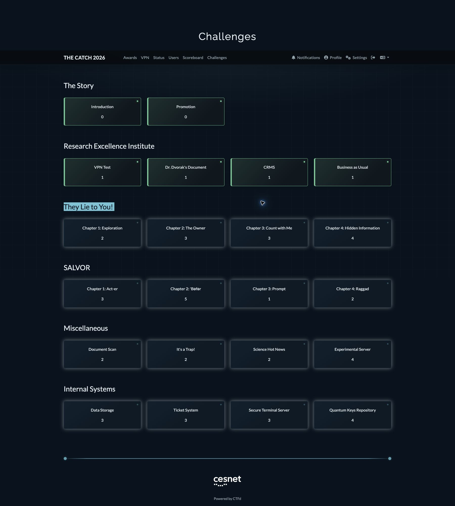

# Promotion — The Story

**Puntos:** 0  
**Flag:** `FLAG{sWX8-Gu1w-QNSA-kpdz}`  
**Estado:** resuelto; se comprobó la aparición de 16 retos adicionales.

## Enunciado

Tras completar la evaluación del Research Excellence Institute, el participante
asciende de Associate Researcher a **Senior Researcher**, se incorpora a SCOPE
y obtiene acceso a las investigaciones operativas.

El propio enunciado indica:

> Enter the code FLAG{sWX8-Gu1w-QNSA-kpdz} to join the team.

## Solución

Abrir **The Story → Promotion**, introducir la flag dada en el enunciado y
pulsar **Submit**. Es una transición de la historia, sin análisis técnico ni
necesidad de usar la pista.

## Resultado

Se desbloquearon cuatro categorías, con cuatro retos en cada una:

- They Lie to You!
- SALVOR
- Miscellaneous
- Internal Systems

