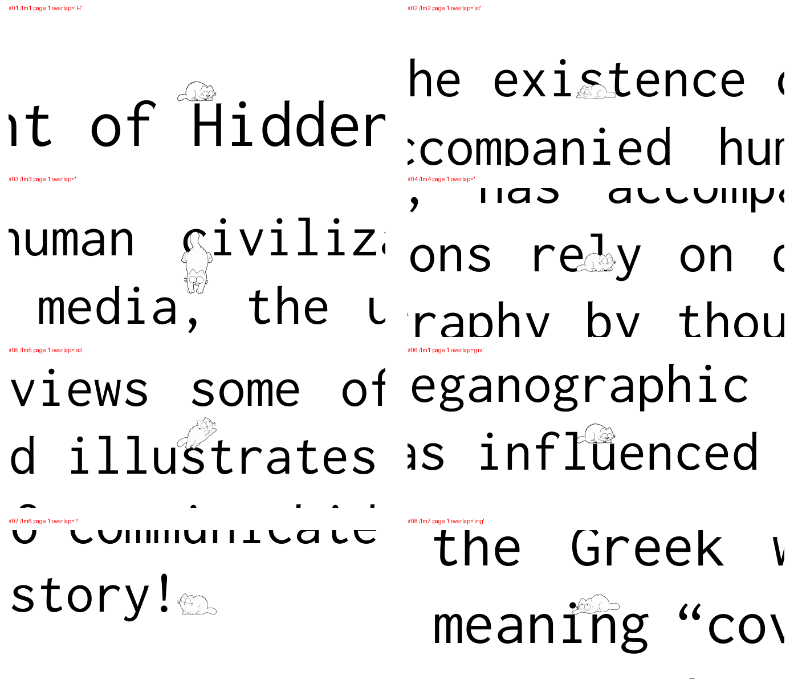
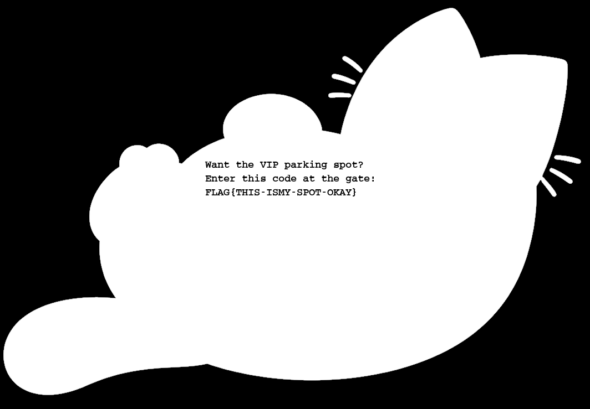
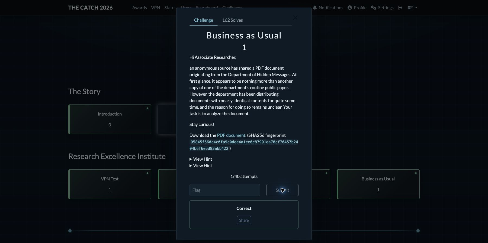

# Business as Usual — Research Excellence Institute

**Puntos:** 1  
**Estado:** resuelto y validado en CTFd el 2026-10-21.  
**Flag:** `FLAG{THIS-ISMY-SPOT-OKAY}`  
**Validación:** respuesta **Correct**, con el contador de la sesión en `1 / 40`.

La solución tiene dos etapas: seguir la mirada de los gatos para obtener un
dominio interno y extraer el canal alfa de la imagen publicada allí.

## Enunciado

Una fuente anónima comparte un documento del Department of Hidden Messages.
El departamento distribuye versiones casi idénticas de sus documentos y hay que
descubrir qué esconden. Las pistas indican que sus empleados tienen 28 gatos y
recomiendan un visor PDF con suficiente zoom para ver incluso sus bigotes.

Archivo: [descarga del reto](https://owncloud.cesnet.cz/index.php/s/VeHUHAxE9DeNVCW/download).

SHA256 del archivo descargado, guardado como `document.pdf`:

```text
95845f56dc4c0fa9c0dee4a1ee6c87991ea78cf76457b2404b6f6e5d83abb422
```

## Mecanismo encontrado

La descarga es un ZIP que contiene `document_DoHM.pdf`, un texto de tres páginas
sobre la historia de la esteganografía. Sus primeras dos páginas contienen 28
gatos diminutos, implementados mediante 11 Form XObjects vectoriales distintos.

**Cada gato mira hacia un carácter del texto.** Su posición y su mirada, juntas,
determinan el carácter. La identidad del dibujo por sí sola no codifica una letra
ni un dígito. Por ejemplo, el mismo `/Im1` permite leer `H`, `u`, `d`, `p` y `c` en
sus cinco apariciones.

Los primeros siete gatos señalan `H`, `i`, `,`, `y`, `o`, `u`, `!`. Esto permite
reconocer el saludo «Hi, you!» y confirmar la forma de lectura.

La transcripción geométrica, conservando el orden de las invocaciones del PDF, es:

```text
Hi,you!Gotto:hiddenpaws6.tcc
```

`Gotto:` se conserva tal como lo transcribe el script. El destino extraído y
confirmado mediante una petición HTTP es:

```text
http://hiddenpaws6.tcc/
```

La mirada ascendente y las variantes de pupilas son relevantes: algunos gatos
miran a la línea superior, otros a la inferior o hacia los lados. Contar bigotes
o convertir las identidades a números pierde esa relación con el texto.



## Reproducción

Dependencias: Python 3, `pymupdf`, `pypdf` y `pillow`. Tesseract permite transcribir
la flag automáticamente; sin él, el script guarda el canal alfa para leerlo.

Desde este directorio:

```bash
python3 -m venv .venv
source .venv/bin/activate
python -m pip install -r requirements.txt
# Opcional, en macOS:
brew install tesseract
python3 solve.py
```

La ejecución predeterminada funciona sin VPN usando la imagen original que se
conserva en `evidence/hiddenpaws6.png`. Obtiene el mensaje del PDF, guarda el canal
alfa y muestra la flag si Tesseract está instalado. No contiene la flag como
respuesta prefijada.

El script interpreta los operadores `q`, `Q`, `cm` y `Do` del PDF, conserva sus
transformaciones y obtiene las posiciones reales de los gatos. Después extrae
las coordenadas de los caracteres y selecciona el más cercano al rayo de mirada.
Las posiciones aproximadas de los ojos y sus direcciones fueron calibradas
visualmente para cada dibujo; no hay una tabla de letras ni el dominio escrito
como respuesta en el decodificador.

El archivo descargado es un ZIP a pesar del nombre `document.pdf`. El script lee
directamente su miembro `document_DoHM.pdf` y no depende de archivos de análisis
ni de scripts auxiliares.

## Segunda etapa: la imagen del servicio

Para repetir también la descarga, hay que conectar la VPN del CTF. En macOS:

```bash
sudo /opt/homebrew/sbin/openvpn --config ../../ctfd_ovpn.ovpn
# En otra terminal, desde el directorio del reto:
python3 solve.py --fetch
```

El DNS interno de la conexión usada fue `10.99.0.1`. La página respondió
`HTTP/1.1 200 OK`, con título **Department of Hidden Messages**, el identificador
**Message No. 6** y una imagen:

```html

```

La imagen descargada de `http://hiddenpaws6.tcc/image.png` es un PNG RGBA de
1064 × 739 píxeles. A simple vista solo muestra un gato. El texto de la flag está
codificado en la transparencia, por lo que hay que visualizar el canal **alfa**
como una imagen en escala de grises:

```python
from PIL import Image

with Image.open("evidence/hiddenpaws6.png") as image:
    image.getchannel("A").save("evidence/hiddenpaws6-alpha.png")
```

El resultado dice:

```text
Want the VIP parking spot?
Enter this code at the gate:
FLAG{THIS-ISMY-SPOT-OKAY}
```



También se puede transcribir con:

```bash
tesseract evidence/hiddenpaws6-alpha.png stdout --psm 11
```

SHA256 del PNG original conservado:

```text
8e8c89f9ae0fc97e9c077b14352707b11a92e1212a5b865b66aa5c2955a6da9b
```

## Validación

Se envió `FLAG{THIS-ISMY-SPOT-OKAY}` al reto **Business as Usual** de la plataforma.
La respuesta fue **Correct**. No se hizo fuerza bruta: la flag se leyó del canal
alfa y se aceptó en el primer envío de esta sesión.



## Por qué se habían atascado los intentos anteriores

La coincidencia entre 28 gatos y una posible representación numérica se tomó
como prueba de una conversión base 11 → base 62. Era una hipótesis sin demostrar.
No hacía falta encontrar un codebook: un mismo dibujo señala letras distintas
según dónde se coloca. Además, ordenar los gatos por la línea de texto más
cercana altera el saludo; hay que conservar el orden del content stream.

El hallazgo decisivo fue reconocer `Hi,you!` en los primeros siete gatos y
seguir leyendo con la misma regla. La segunda etapa usa un canal que se pierde
si solo se inspeccionan los componentes RGB.

## Archivos conservados

| Archivo | Uso |
|---|---|
| `document.pdf` | Descarga original; en realidad es el ZIP del reto. |
| `extracted/document_DoHM.pdf` | PDF original extraído, para inspección visual. |
| `solve.py`, `requirements.txt` | Solución reproducible y dependencias. |
| `evidence/cat-gazes.png` | Recortes que explican la lectura de los gatos. |
| `evidence/hiddenpaws6.png` | PNG original recibido del servicio. |
| `evidence/hiddenpaws6-alpha.png` | Canal alfa donde se lee la flag. |
| `evidence/ctfd-correct.jpg` | Confirmación de aceptación en la plataforma. |
